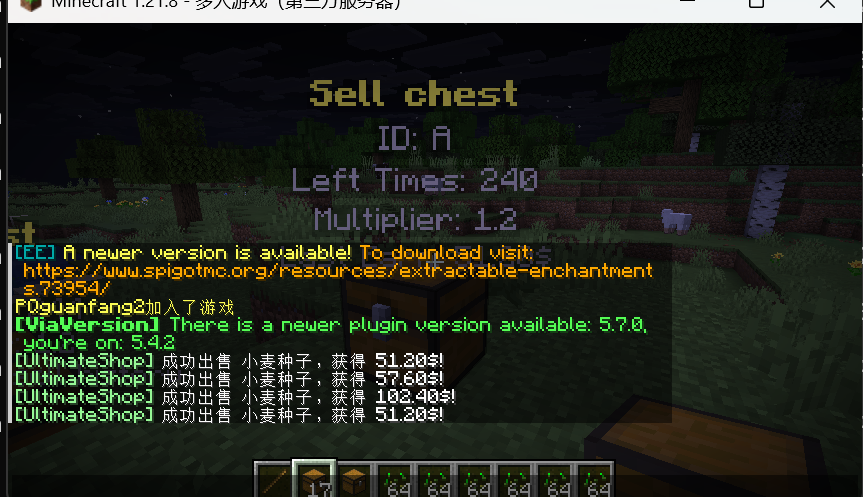

# 🎁出售箱 - 付费版


**出售箱**尚未作为 UltimateShop 的核心功能正式推出，仍处于早期测试阶段。未来可能正式发布，也可能因无法修复的严重问题而被移除。\
此功能自 **4.2.0b** 起可用。



升级到 **4.2.6** 后，升级前放置的出售箱会失效，因为其位置存储逻辑发生了变化。让玩家重新放置出售箱即可解决。


## 限制

* Folia 服务器<mark style="color:red;">**不支持**</mark>此功能。
* 出售箱无法与其他箱子合成大箱子。
* 出售箱的位置与数据保存在世界中，插件本身不另行保存。世界损坏后，无法恢复这些数据。&#x20;
* 服务器意外崩溃导致世界回档时，出售箱也会回档。但经济插件可能已保存出售收入，因此存在重复获得货币的风险。
* 出售箱只能监听原版常见的方块变化，例如破坏、爆炸等。意外情况或其他插件修改方块时，出售箱可能已被摧毁，但插件未能察觉，仍将其视为存在。启用全息显示后，可能出现箱子已损坏而全息文本仍保留的情况。
* 无法计算出售箱的累计收益。UltimateShop 支持单件商品包含多种价格类型，并非只是一个物品堆叠对应一个 `double` 类型的 **Vault** 金额。如果只有单一金额，直接相加即可；但本插件还支持自定义虚拟价格等类型，因此很难汇总总收入。不过，全息文本支持显示最近一次收益。
* 此外，也可能存在其他尚未按预期实现的情况。

## 注意事项

* 只有区块已加载且所有者在线时，出售箱才会工作。目前不计划支持多人共享同一出售箱。
* 只有放置者被认定为所有者，但任何玩家都可以破坏出售箱。
* 支持动态价格商品。例如基础出售价格为 10，每售出一次下降 1，则出售多个商品时会依次计算为 10 + 9 + 8 + 7 + 6 + 5……。

## 配置

所有出售箱配置位于 `sell_chests` 目录，示例如下：

```yaml
display-item:
  material: CHEST
  name: '&dSell Chest &7(500 times)'
  lore:
    - '&fPlace this chest in your world to sell items!'
    - ''
    - '&cLeft usages: {times}'

usage-times: 500

multiplier: 1.2

y-offset: 2.25
holograms:
  - '&e&lSell chest'
  - '&7ID: {id}'
  - '&7Owner: {owner}'
  - '&7Left Times: {usage}'
  - '&7Multiplier: {multiplier}'
  - '&7Last Earn: {price}'

actions:
  1:
    type: sound
    sound: 'block.note_block.pling'

conditions: []
```


出售箱的展示物品材质<mark style="color:red;">**只能**</mark>使用 **CHEST**，否则无法工作！


多数设置与[出售棒](sell-stick-premium.md)一致，以下只说明区别：

* `holograms`：出售箱上方的全息文本内容，需要启用[受支持的全息插件](../info/compatibility.md#directly-supported-protection-plugins-list-premium-1)。
* `y-offset`：全息文本相对于箱子的高度偏移，可按文本行数调整。

### 全息文本占位符

| 占位符 | 含义 |
| --- | --- |
| `{id}` | 出售箱配置 ID。 |
| `{owner}` | 放置出售箱的玩家用户名。 |
| `{usage}` | 剩余使用次数；无限次出售箱显示配置的无限次数文本。 |
| `{multiplier}` | 出售价格倍率。 |
| `{price}` | 最近一次成功出售的收益；没有历史记录时显示 `price-empty`。 |

## config.yml 中的设置

```yaml
  sell-chest:
    enabled: true
    debug: false
    period-ticks: 600
    batch-count: 5
    send-sell-message: true
    price-empty: '{lang}'
    hologram:
      enabled: true
      # Support value: DecentHolograms, CMI
      plugin: 'DecentHolograms'
```

* `enabled`：是否启用。不使用此功能时，可以关闭以降低性能开销。
* `debug`：启用后，在控制台输出出售箱相关调试信息。
* `period-ticks` 与 `batch-count`：

  #### `period-ticks: 600`

  控制出售箱系统的运行间隔，单位为 **Minecraft 游戏刻**，20 刻等于 1 秒。

  * `600 ticks = 30 seconds`，即 600 刻为 30 秒。
  * 系统每 30 秒处理**一批**出售箱。

  #### `batch-count: 5`

  控制每轮将全部出售箱划分为多少批：

  * 全部出售箱分为 **5 批**。
  * **每个运行间隔只处理一批**。
  * 完整一轮需要执行 **5 次**。

  这样既不必为每个出售箱单独创建循环任务，也不会在同一次任务中处理全部箱子，从而避免出售箱过多时造成性能下降或卡顿。
* `send-sell-message`：每次出售后是否发送消息。
* `price-empty`：没有历史收益时，全息文本显示的内容。
* `hologram`：全息显示设置。&#x20;
  * `enabled`：是否在出售箱上方显示全息文本。
  * `plugin`：使用的全息插件，支持列表见[这里](../info/compatibility.md#directly-supported-protection-plugins-list-premium-1)。

## 效果展示

<figure><figcaption></figcaption></figure>
