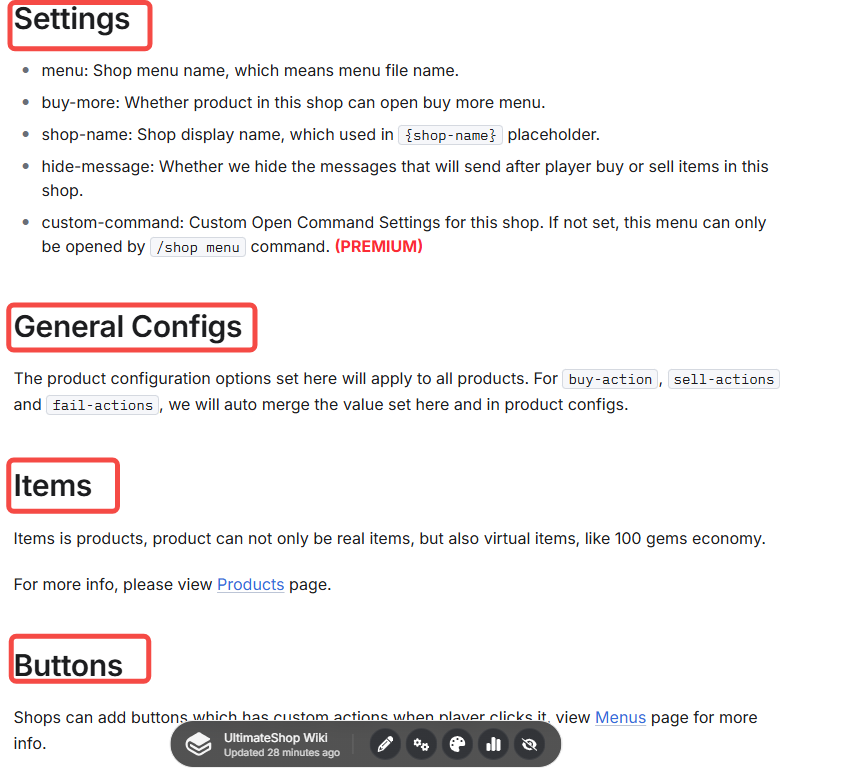
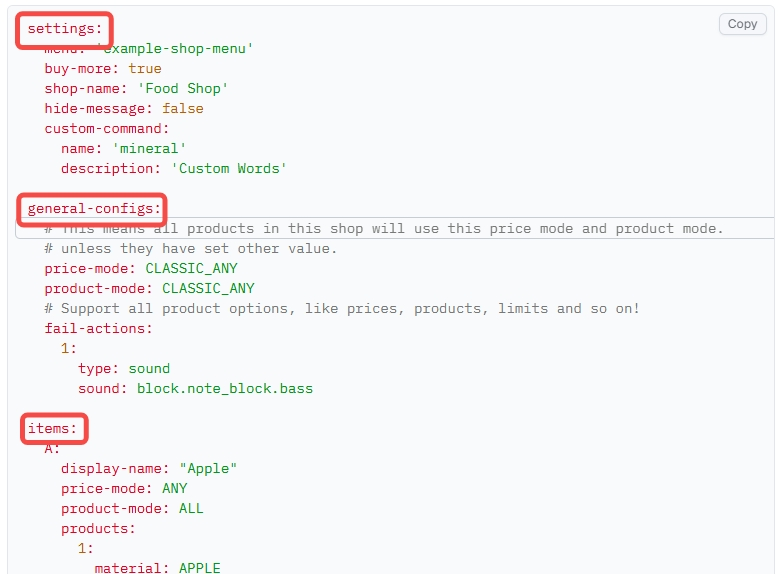
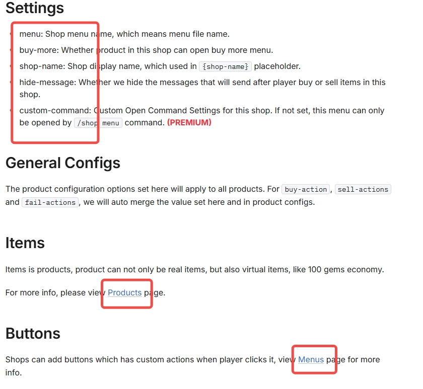
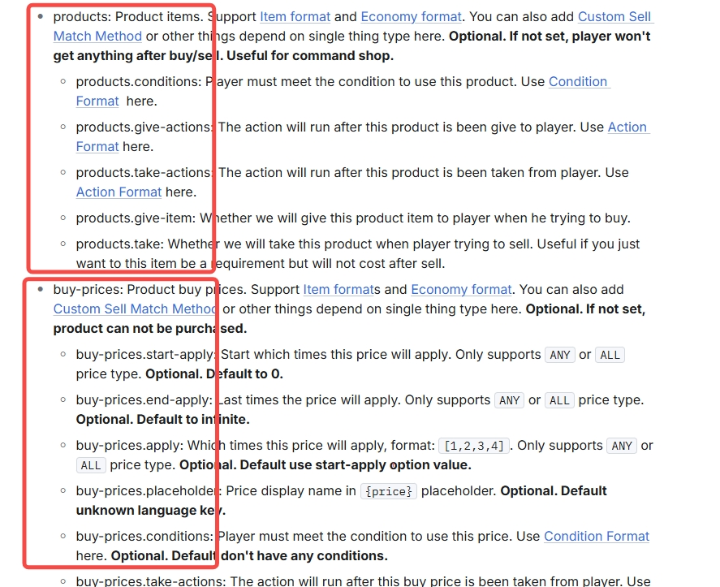
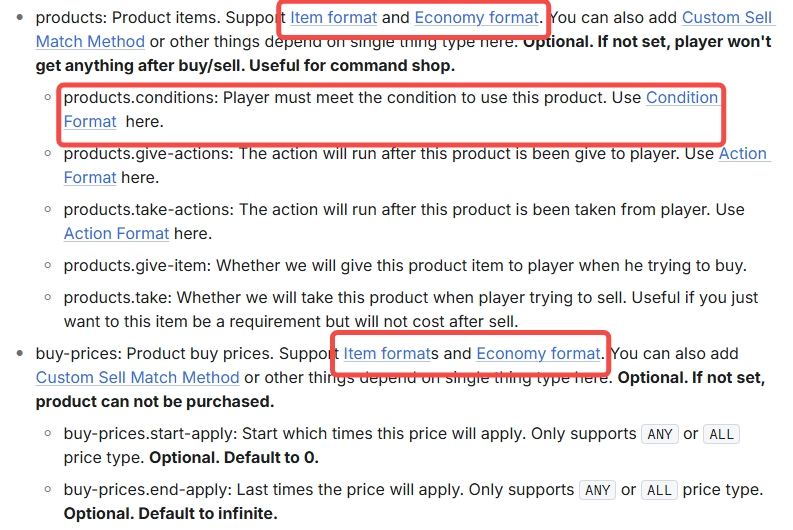

# 📊看懂 YAML / 本 Wiki

UltimateShop 的所有配置文件都用 YAML 格式，掌握 YAML 语法是改配置、做自定义的前提。下面用插件里的真实例子过一遍。

***

## 基本语法

YAML 的基本结构是 `键: 值`。例如：

```yaml
debug: false
```

重要规则：

1. 键区分大小写。
2. 冒号后面必须有一个空格。
3. 当值包含特殊字符（`:` 或 `&`）时，将其括在引号中：`prefix: "&a[UltimateShop]"`
4. 当值包含单引号（`'`）时，用两个单引号转义：`message: "You can''t buy this item!"`

## 层次结构和缩进

缩进表示 YAML 里的父子关系，每层缩进两个空格。例如：

```yaml
auto-save:
  hide-message: false
```

这里：

* `auto-save` 是父键。
* `hide-message` 是它的子键，表示这一项只对自动保存功能生效。
* `false` 是值，表示自动保存时不隐藏提示。

再看一个更复杂的商店配置：

```yaml
settings:
  menu: 'example-shop-menu'
  buy-more: true
  shop-name: 'Blocks Shop'
  hide-message: false

items:
  A:
    price-mode: CLASSIC_ALL
    product-mode: CLASSIC_ALL
    products:
      1:
        material: GRASS_BLOCK
        amount: 1
    buy-prices:
      1:
        economy-plugin: Vault
        amount: '0.63'
        placeholder: '{amount}$'
```

1️⃣ 第 1 层（顶层）有两个主根键：

* settings
* items

它们并列在配置的最上层。既然是商店配置，可用的顶层选项就写在[商店](../shops/shops.md)页面里——那一页把可用键用很大的字号标了出来。

<figure><figcaption></figcaption></figure>

并配了很详细的示例。

<figure><figcaption></figcaption></figure>

每一项都有详细说明：

<figure><figcaption></figcaption></figure>

2️⃣ 第 2 层，`settings` 之下：

* menu
* buy-more
* shop-name
* hide-message\
  都是 `settings` 的**子键**。

也就是说它们都是这家商店的设置，放到别处<mark style="color:red;">**不会**</mark>生效。

再看 `items` 之下：

* **A** 是代表一个商品的**子键**。`A` 就是这个商品的 ID，`A` 下面的内容只对这个商品生效。

<pre class="language-yaml"><code class="lang-yaml"><strong>items:
</strong><strong>  buy-prices: # Will not work
</strong>      1:
        economy-plugin: Vault
        amount: '0.63'
        placeholder: '{amount}$'
  A:
    menu: 'example-shop-menu' # Will not work.
    buy-more: true # Will not work.
    shop-name: 'Blocks Shop' # Will not work.
    hide-message: false # Will not work.
    price-mode: CLASSIC_ALL # Only work for product A
    product-mode: CLASSIC_ALL # Only work for product A
    products: # Only work for product A
      1:
        material: GRASS_BLOCK
        amount: 1
</code></pre>

3️⃣ 第 3 层，`items` → `A` 之下：

* price-mode
* product-mode
* products
* buy-prices
* 等等。\
  都是 `A` 的**子项**。这些选项只对商品 A 生效，不要挪到别处。

<figure><figcaption></figcaption></figure>

这里属于商品配置，可用选项和详细说明都在[商品](../shops/products.md)页面。

```yaml
items: # Will work.
  B: # Will work.
    products: # Will work.
      1: # Will work.
        material: APPLE # Will work.
        amount: 64 # Will work.
        give-actions: # Will work.
          1: # Will work.
            multi-once: true # Will work.
            type: message # Will work.
            message: 'eco give {player} {amount}' # Will work.
```

4️⃣ 第 4 层，`products` 之下：

* “`1`”表示第 1 个定义的商品项。&#x20;

在 `buy-prices` 之下：

* “`1`”表示第 1 个定义的价格组。

价格和商品项都可以定义任意多个，相关选项见[单个条目](../shops/products-config-single-thing/)页面。

5️⃣ 第 5 层，`products` → `1` 之下：

* `material: GRASS_BLOCK` → 物品类型。
* `amount: 1` → 数量。

写法遵循 [ItemFormat](itemformat-tm/)。

在 `buy-prices` → `1` 下：

* `economy-plugin: Vault` → 使用的经济系统。
* `amount: '0.63'` → 价格。
* `placeholder: '{amount}$'` → 价格如何显示。

写法遵循 [EconomyFormat](economyformat-tm.md) 以及价格节里的 placeholder 选项。

<figure><figcaption></figcaption></figure>

## 层次树图

```fish
settings
│
├─ menu
├─ buy-more
├─ shop-name
└─ hide-message

items
└─ A
   ├─ price-mode
   ├─ product-mode
   ├─ products
   │   └─ 1
   │      ├─ material
   │      └─ amount
   └─ buy-prices
       └─ 1
          ├─ economy-plugin
          ├─ amount
          └─ placeholder
```

## 列表

一个键要存多个值时，就用列表。&#x20;

示例：

<pre class="language-yaml"><code class="lang-yaml">menu:
  secret-shop-items:
    - diamond_sword
<strong>    - netherite_pickaxe
</strong>    - enchanted_golden_apple
</code></pre>

每个“`-`”都要比它的父键多缩进两个空格。

## 空值和默认值

空列表表示为：

```yaml
menu:
  secret-shop-items: []
```

`[]` 表示列表为空，插件会使用默认设置。这一行通常可以直接删掉。
