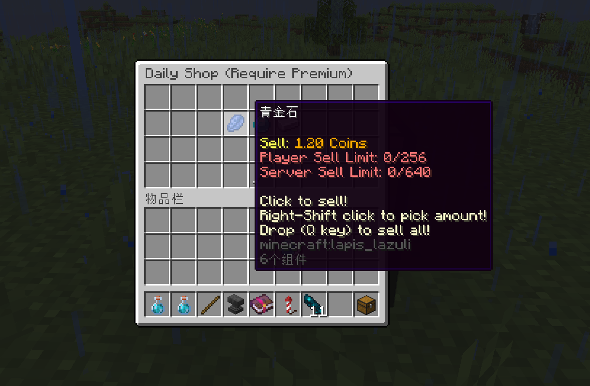

# 📅示例：每日商店/轮换商店


此示例仅适用于 **UltimateShop** 的 <mark style="color:red;">**付费版**</mark> 版本！\
本例用随机占位符在同一家商店里展示不同商品；你也可以用条件占位符，让不同条件显示不同商品，示例见[这里](../placeholders/conditional-placeholder-premium.md#example-conditional-product)。


## 创建随机占位符

我们需要先创建一个随机占位符。&#x20;

本例在 `random_placeholder` 文件夹下新建了一个名为 `daily.yml` 的随机占位符配置，各项含义是：

* `reset-mode` 与 `reset-time`：让这个占位符每天刷新。
* `element-amount`：每次刷新随机抽 5 个元素，正好对应每日商店的槽位数。
* `elements`：抽到的结果会通过条件系统决定该槽位放哪个商品，所以元素总数应等于每日商店中所有可能出现的商品数。

本例中每日商店有 5 个槽位、7 种可能的商品，所以每天会有 2 种被藏起来，随机挑 5 种上架。

随机占位符的更多说明见[随机占位符](../placeholders/random-placeholder-premium.md)页面。

```yaml
reset-mode: TIMED
reset-time: '00:00:00'
element-amount: 5
per-player-element: false
element-sort: true
elements:
  - 'A'
  - 'B'
  - 'C'
  - 'D'
  - 'E'
  - 'F'
  - 'G'
```

## 配置商店

本例用到的各项选项在[商店](shops.md)页面有详细说明，若不确定某项的作用可以查阅该页。

添加 `A` 到 `G` 共 7 个商品，它们的 ID 必须与占位符里的元素一致。

```yaml
settings:
  menu: 'daily-shop-menu' # The menu ID
  buy-more: true
  shop-name: 'Daily Shop (Require Premium)'
  hide-message: false

general-configs:
  price-mode: CLASSIC_ANY
  product-mode: CLASSIC_ANY
  sell-limits:
    global: 640
    default: 18
    vip: 256
  sell-limits-conditions:
    vip:
      1:
        type: permission
        permission: 'group.vip'
  sell-times-reset-mode: 'COOLDOWN_TIMED'
  sell-times-reset-time: '{random_reset}'

items:
  A:
    products:
      1:
        material: REDSTONE
        amount: 1
    sell-prices:
      1:
        economy-plugin: Vault
        amount: 1
        placeholder: '&6{amount} Coins'
        start-apply: 0
  B:
    products:
      1:
        material: IRON_INGOT
        amount: 1
    sell-prices:
      1:
        economy-plugin: Vault
        amount: 3
        placeholder: '&6{amount} Coins'
        start-apply: 0
  C:
    products:
      1:
        material: GOLD_INGOT
        amount: 1
    sell-prices:
      1:
        economy-plugin: Vault
        amount: 1.6
        placeholder: '&6{amount} Coins'
        start-apply: 0
  D:
    products:
      1:
        material: COPPER_INGOT
        amount: 1
    sell-prices:
      1:
        economy-plugin: Vault
        amount: 2
        placeholder: '&6{amount} Coins'
        start-apply: 0
  E:
    products:
      1:
        material: DIAMOND
        amount: 1
    sell-prices:
      1:
        economy-plugin: Vault
        amount: 0.8
        placeholder: '&6{amount} Coins'
        start-apply: 0
  F:
    products:
      1:
        material: LAPIS_LAZULI
        amount: 1
      2:
        material: EMERALD
        amount: 1
    sell-prices:
      1:
        economy-plugin: Vault
        amount: 1.2
        placeholder: '&6{amount} Coins'
        start-apply: 0
      2:
        economy-plugin: Vault
        amount: 3.3
        placeholder: '&6{amount} Coins'
        start-apply: 0
  G:
    products:
      1:
        material: EMERALD
        amount: 1
    sell-prices:
      1:
        economy-plugin: Vault
        amount: 5
        placeholder: '&6{amount} Coins'
        start-apply: 0
```

## 配置菜单

本例用到的各项选项在[菜单](../menus/general-menus.md)页面有详细说明，若不确定某项的作用可以查阅该页。

```yaml
# PREMIUM version only.

title: '{shop-name}'
size: 36

open-actions:
  1:
    type: sound
    sound: item.book.page_turn

dynamic-layout: true

layout:
  - '000000000'
  - '000`{random_daily;;1}``{random_daily;;2}``{random_daily;;3}`000'
  - '000000000'
  - 'a0003000b'

buttons:
  3:
    display-item:
      material: ARROW
      name: '&c« Go back'
    actions:
      1:
        type: open_menu
        menu: main
```

## 效果展示

<figure><figcaption></figcaption></figure>
