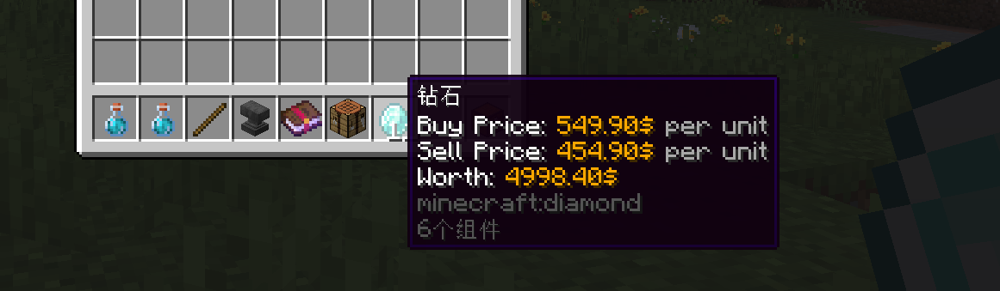

# 💰商品配置：单项内容

本页按插件实际的处理逻辑，说明商品配置中的 `products`、`buy-prices` 与 `sell-prices` 三节。

## 什么是单项？

在商店商品中，`products`、`buy-prices`、`sell-prices` 下的每一个独立条目（如 `1:`、`2:`）都称为一个**单项**。一个商品可以包含任意多个单项。

* **`products`（商品内容）**：可选。买入时玩家获得的物品/奖励，卖出时玩家需要交出的物品。若省略整节，买入和卖出仍会正常执行 `buy-actions` / `sell-actions`，但不会发放或扣除任何物品（常用于纯命令商店）。
* **`buy-prices`（购买价格）**：可选。买入该商品需要支付的代价；不配置则无法购买。
* **`sell-prices`（出售价格）**：可选。卖出该商品后玩家获得的收益；不配置则无法出售。

```yaml
items:
  A:
    products:
      1:
        material: emerald
      2:
        material: diamond
    buy-prices:
      1:
        economy-plugin: Vault
        amount: 100
        placeholder: '{amount}$'
    sell-prices:
      1:
        economy-plugin: Vault
        amount: 20
        placeholder: '{amount}$'
```

上例中，`products.1`、`products.2`、`buy-prices.1`、`sell-prices.1` 各自都是一个单项。

## 插件如何处理单项？

玩家进行购买或出售时，插件会按以下顺序处理每一节的单项：

1. 读取 `products`、`buy-prices` 或 `sell-prices` 下的全部单项。
2. 使用每个单项的 `apply-conditions`（旧版写法为 `conditions`）进行过滤。
3. 根据该节的模式（`ANY`、`ALL`、`CLASSIC_ANY`、`CLASSIC_ALL`）决定本次交易选中哪些单项。
4. 计算每个被选中单项的实际数量（`amount`）。
5. 检查玩家是否持有足够的物品或货币。
6. 校验每个被选中单项的 `require-conditions`。
7. 实际发放或扣除物品/货币，并执行单项对应的 `give-actions` / `take-actions`。


`apply-conditions` 在**筛选单项之前**生效，决定该条目是否参与本次交易；`require-conditions` 在**选中并算完数量之后**校验，决定这笔交易是否允许成交。


## 单项的类型

插件会根据单项中填写的键，自动识别它属于哪种类型。

### 原版物品

使用[物品格式（ItemFormat™）](../../format/itemformat-tm/)定义普通的 Minecraft 原版物品，可用于 `products`、`buy-prices` 与 `sell-prices`。

```yaml
products:
  1:
    material: emerald
  2:
    material: diamond
    amount: 16
```

### 挂钩物品

通过[兼容插件](../../info/compatibility.md)引入自定义物品，同样使用[物品格式（ItemFormat™）](../../format/itemformat-tm/)，可用于 `products`、`buy-prices` 与 `sell-prices`。

```yaml
products:
  1:
    hook-plugin: MMOItems
    hook-item: 'AXE;;MAGIC_AXE'
```

### 匹配物品

使用[自定义物品匹配方式](../../features/custom-item-match-method.md)按 Lore、NBT、名称等规则模糊匹配玩家背包中的物品，常用于无固定物品 ID 的自定义物品（可用于购买价格或商品回收）。

```yaml
products:
  1:
    match-item:
      contains-lore:
        - 'Magic Flight Paper'
    amount: 64
```

### 原版经济 / 挂钩经济

直接操作金币、点券、经验等经济数值，写法见[经济格式（EconomyFormat™）](../../format/economyformat-tm.md)，可用于 `products`、`buy-prices` 与 `sell-prices`。

```yaml
buy-prices:
  1:
    economy-plugin: Vault
    amount: 15
    placeholder: '{amount}$'
```

### 自定义 <mark style="color:red;">- 付费版</mark>

当你需要对接插件未内置支持的数值或货币系统时，可通过 `match-placeholder` 读取玩家当前的数值占位符（用于校验持有量），再配合 `take-actions` / `give-actions` 执行实际增减。

```yaml
buy-prices:
  1:
    match-placeholder: '%player_health%'
    amount: 5
    placeholder: '{amount} Health'
    take-actions:
      1:
        multi-once: true
        type: console_command
        command: 'health take {player} {amount}'
```

### 免费 / 空

若某个单项既未配置物品、经济，也未配置 `match-item` 或 `match-placeholder`，则视为免费条目，常用于纯命令商店、权限商店或仅通过动作发奖的礼包。

## 单项的选项

### `amount`

单项的基础数量，支持固定数字、PlaceholderAPI 变量、[内置占位符](../../placeholders/built-in-placeholders.md)以及[数学计算格式](../../format/math-calculate-format.md)动态公式。

```yaml
amount: '55 + ({buy-times-server} - {sell-times-server}) * 0.1'
```

### `max-sell-amount`

可选，可写在单个 `products` 或 `sell-prices` 条目下，用于手动指定 **Sell All（全部出售）** 时该单项最多可出售的次数。


使用动态价格或动态数量时，若不填写 `max-sell-amount`，插件只能逐笔穷举试算来寻找最大可售次数。根据价格公式填写此选项后，插件可直接算出上限，显著提升 Sell All 的性能。具体公式示例见[动态价格](../../dynamic-prices/dynamic-price.md)。


**多条目合并规则：**
* `ALL` 模式下，取所有已配置公式结果中的最小值。
* `ANY` 模式下，仅当所有参与交易的条目都配置了该公式时，才会将各条目上限相加。

如需按 Vault 回收限额的剩余额度反推次数，可参考[回收限额示例 - Sell All 怎么算最多能卖几次](../../features/sell-income-limits-example.md#sell-all-怎么算最多能卖几次)。

**公式可用占位符：**

| 占位符 | 可用位置 | 说明 |
| --- | --- | --- |
| `{stock}` | 仅 `products` | 玩家当前持有的该物品数量（经济类单项则为当前余额） |
| `{sell-unit-income}` | 仅 `CLASSIC_ANY` / `CLASSIC_ALL` 模式下的 `sell-prices` | 单次出售实际到账的金额（已含售价倍率）；引用同一 Shared Price 模板的卖价项会合并计算 |
| `{require-conditions.<key>.value}` | `products` 与 `sell-prices` | 读取对应 `require-conditions` 条目中的 `value` 数值 |
| `{buy-times-player}`、`{buy-times-server}`、`{buy-times-increment}`、`{sell-times-player}`、`{sell-times-server}`、`{sell-times-increment}` | `products` 与 `sell-prices`（任意模式） | 本次出售开始前的买卖次数，以及每笔交易增加的计数步长 |
| `{custom_...}` 等内置占位符、`%...%` | 所有单项 | 与 `amount` 相同，支持内置占位符与 PlaceholderAPI，详见[内置占位符](../../placeholders/built-in-placeholders.md) |

**注意事项：**

* 公式中**不能使用 `{amount}`**（该公式本身就是为了求解次数，此时尚未得出次数）；如需读取上限数值，请使用 `{require-conditions.<key>.value}`。
* `{buy-times-increment}` / `{sell-times-increment}` 对应商品的计数增量配置（即每笔交易占用多少次计数）。当需要把「剩余可占用次数」换算成「可交易笔数」时才需使用，例如：`max-sell-amount: '({require-conditions.1.value} - {buy-times-server}) / {buy-times-increment}'`。
* `{stock}` 仅在 `products` 中会被替换；若误写在 `sell-prices` 中会原样保留并导致公式失效。
* `{sell-unit-income}` 仅存在于卖价侧，且在 `ANY` / `ALL` 动态价格模式下会被跳过（因为批内单价会变化）；动态价格请改用次数计数器推导，见[动态价格](../../dynamic-prices/dynamic-price.md)。
* 所有次数计数器均取「本次出售开始前」的值（例如从未卖过该商品的玩家，`{sell-times-player}` 为 `0`）。
* 结果会向下取整为整数，且不会超过库存、`sell-limits` 与 `sell.max-amount` 允许的范围；负值按 `0` 处理。
* 若公式求值失败（占位符拼错、除以 `0`、未开启 `math.enabled`），该公式会被静默忽略并退回默认计算，不会导致出售失败；使用 `min()`、`max()`、`ceil()` 等函数需开启 `math.enable-function`。
* 商品开启 `price-modifier: true` 时，`sell-prices` 中的 `max-sell-amount` 公式不生效。

**示例（商品侧按库存限制，卖价侧按每日收入上限限制）：**

```yaml
products:
  1:
    material: EMERALD
    amount: 4
    max-sell-amount: '{stock} / 4'

sell-prices:
  1:
    economy-plugin: Vault
    amount: 20
    placeholder: '{amount}$'
    max-sell-amount: '({require-conditions.1.value} - {custom_sell_daily}) / {sell-unit-income}'
    require-conditions:
      1:
        type: placeholder
        placeholder: '{custom_sell_daily} + {amount}'
        rule: '<='
        value: '10000'
```

### `apply-conditions` 与 `require-conditions`

* **`apply-conditions`**：决定该单项是否纳入本次交易的候选列表。条件不满足时，插件会直接忽略该条目，常用于 VIP 专属价格档位、特定条件奖励或按权限区分定价。
* **`require-conditions`**：在单项已被选中并算出数量后校验。条件不满足时，整笔交易会被拦截并失败，常用于购买资格校验、限额拦截等。

```yaml
products:
  1:
    material: PAPER
    amount: 1
  2:
    material: PAPER
    amount: 2
    apply-conditions:
      1:
        type: permission
        permission: group.vip

buy-prices:
  1:
    economy-plugin: Vault
    amount: 50
    placeholder: '{amount}$'
    require-conditions:
      1:
        type: permission
        permission: shop.buy.special
```

上例中，普通玩家只拿到 `products.1`，VIP 玩家可额外拿到 `products.2`；而购买价格 `buy-prices.1` 始终会被选中，但没有 `shop.buy.special` 权限的玩家在付款时会被拦截。

### `give-actions` 与 `take-actions`

* **`give-actions`**：将该单项发放给玩家时执行的动作（如发放命令奖励、权限或自定义货币）。
* **`take-actions`**：从玩家扣除该单项时执行的动作（如扣除自定义货币或执行扣费命令）。

### `give-item` 与 `take`

* **`give-item`**：仅对物品类单项有效。设为 `false` 时，插件不会真的把该物品发给玩家，但 `give-actions` 仍会正常执行（命令商店常用）。
* **`take`**：设为 `false` 时，插件仍会检查玩家是否持有该物品，但交易时不会将其消耗（适合「需持有某信物但不消耗」的场景）。

## 单项动作与物品动作的区别

单项下的 `give-actions` / `take-actions` 与商品外层的 `buy-actions` / `sell-actions` 作用层级不同：

* **单项动作（`give-actions` / `take-actions`）**：仅当**该具体单项被选中并实际发生发放/扣除**时才执行，适合绑定到某个特定奖励分支或自定义货币分支；其中的 `{amount}` 代表**该单项最终计算出的数量**。
* **物品动作（`buy-actions` / `sell-actions`）**：只要**整笔买入或卖出交易成功**就会执行，与具体走了哪条价格/商品分支无关，适合做全局提示、音效或日志；其中的 `{amount}` 代表**商品层级的交易数量**（通常为界面上选择的购买/出售份数；若关闭了 `display-item.calculate-amount`，则为买入/卖出的次数）。

```yaml
products:
  1:
    material: PAPER
    amount: 4
    give-actions:
      1:
        type: message
        message: 'Single thing amount = {amount}'

buy-actions:
  1:
    type: message
    message: 'Item action amount = {amount}'
```

简单判断原则：逻辑属于某条特定分支时放单项动作；无论走哪条分支都要执行时放物品动作。

## 仅适用于价格的选项

以下选项主要用于 `buy-prices` 与 `sell-prices`：

* **`placeholder`**：定义 `{buy-price}` / `{sell-price}` 等价格占位符的显示格式（如 `placeholder: '{amount}$'`）。支持 `{amount}`、`{status}`（动态价格状态）、`{display}`（物品名称，会带来额外性能开销）以及所有 PlaceholderAPI 变量。
* **`start-apply` / `end-apply` / `apply`**：控制价格在买卖次数达到特定区间时才生效，仅在 `ANY` / `ALL` 非经典模式下有效，可用于实现「早买优惠」「阶梯涨价」等效果。
* **`min-amount` 与 `max-amount`**：限制动态公式算出的最终价格上下限，防止数值过小或溢出。

```yaml
buy-prices:
  1:
    economy-plugin: Vault
    amount: '55 + {buy-times-player} * 0.5'
    min-amount: 55
    max-amount: 500
    placeholder: '{amount}$'
```

## 模式说明：`ANY`、`ALL`、`CLASSIC_ANY`、`CLASSIC_ALL`

* **`CLASSIC_ALL`**：所有适用的单项作为一个固定组合同时生效（最常用，适合固定价格的普通商店）。
* **`CLASSIC_ANY`**：每次只从适用的单项中选用一个，不随批内数量动态切换。
* **`ALL`**：所有适用的单项同时生效，且支持动态公式与 `start-apply` 等区间参数在批内逐笔变化。
* **`ANY`**：每次只选用一个适用的单项，且生效区间会随数量动态切换。

常规配置建议从 `CLASSIC_ALL` 起步；需要「多选一」时用 `CLASSIC_ANY`；只有使用动态价格公式或生效区间时才需要切换为 `ALL` 或 `ANY`。

## 共享条件键

在 `config.yml` 中配置共享条件键名后，可以将 `apply-conditions` 集中写到商品外层的独立配置节中（`require-conditions` 仍需写在单项内部）：

```yaml
conditions:
  products-key: 'products-conditions'
  buy-prices-key: 'buy-prices-conditions'
  sell-prices-key: 'sell-prices-conditions'
  display-item-key: 'display-item-conditions'
```

在商店配置中按对应键名引用即可：

```yaml
products:
  one:
    material: REDSTONE
  two:
    material: IRON_INGOT

products-conditions:
  one:
    1:
      type: placeholder
      placeholder: '{random_daily}'
      rule: '=='
      value: 'A'
  two:
    1:
      type: placeholder
      placeholder: '{random_daily}'
      rule: '=='
      value: 'B'
```

## 常见配置示例

### 示例 A：普通物品商店

买入扣除金币并给予苹果，卖出扣除苹果并给予金币：

```yaml
A:
  price-mode: CLASSIC_ALL
  product-mode: CLASSIC_ALL
  products:
    1:
      material: APPLE
      amount: 64
  buy-prices:
    1:
      economy-plugin: Vault
      amount: 150
      placeholder: '{amount}$'
  sell-prices:
    1:
      economy-plugin: Vault
      amount: 30
      placeholder: '{amount}$'
```

### 示例 B：命令商店

命令商店有两种常见写法：一种是省略 `products` 直接写 `buy-actions`（需要手动配置 `display-item`）；另一种是在 `products` 中配置一个虚拟展示物品并设置 `give-item: false`，通过 `give-actions` 发奖。两种写法基础效果相同，但后者可以配合 `apply-conditions` 为不同权限组发放不同奖励：

```yaml
  A:
    price-mode: CLASSIC_ALL
    product-mode: CLASSIC_ALL
    display-item:
      name: 'Magic Crate Key'
      material: PAPER
      custom-model-data: 500
      amount: 1
    buy-prices:
      1:
        economy-plugin: Vault
        amount: 150
        placeholder: '{amount}⛂'
    buy-actions:
      1:
        type: console_command
        command: "crate give {player} magic"
      2:
        # 批量购买时如在命令中使用 {amount}，需加上 multi-once: true 避免重复执行
        multi-once: true
        type: console_command
        command: "crate give {player} magic {amount}"

  B:
    price-mode: CLASSIC_ALL
    product-mode: CLASSIC_ALL
    products:
      1:
        name: 'Magic Crate Key'
        material: PAPER
        custom-model-data: 500
        amount: 1
        give-item: false
        give-actions:
          1:
            multi-once: true
            type: console_command
            command: "crate give {player} magic {amount}"
      2:
        name: 'Magic Crate Key (VIP 额外赠送)'
        material: PAPER
        custom-model-data: 500
        amount: 1
        give-item: false
        give-actions:
          1:
            multi-once: true
            type: console_command
            command: "crate give {player} magic {amount}"
        apply-conditions:
          1:
            type: permission
            permission: group.vip
    buy-prices:
      1:
        economy-plugin: Vault
        amount: 150
        placeholder: '{amount}⛂'
```

## 在物品描述中自动显示价格

如果你希望玩家背包里的物品直接显示商店的买卖价格与总价值，可以搭配 **MythicChanger**（需前置 `packetevents`）：

1. 下载并安装 [MythicChanger](https://www.spigotmc.org/resources/mythicchanger-auto-match-change-drag-change-gui-change-in-1-plugin-1-14-1-21-8.98523/)。
2. 在 `plugins/MythicChanger/rules` 目录下新建 `shop-display.yml`。
3. 填入以下内容并重启服务器：

```yaml
weight: 15

only-in-player-inventory: true

fake-changes:
  add-price-lore:
    - '&fBuy Price: &6{buy-price} &7per unit'
    - '&fSell Price: &6{sell-price} &7per unit'
    - '&fWorth: &6{total-price}'
```

<figure><figcaption></figcaption></figure>
