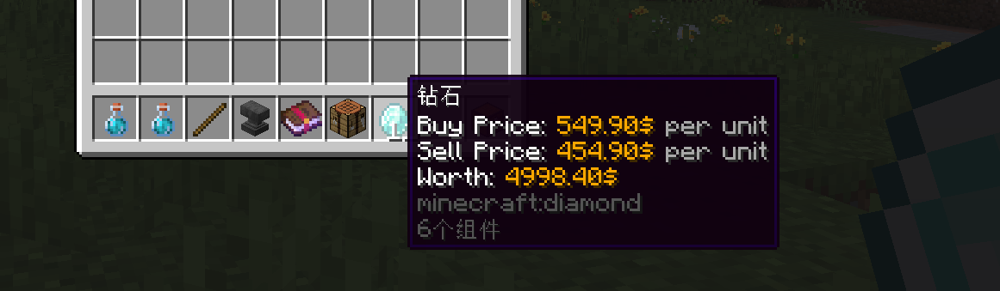

# 💰商品的另一种配置写法：单项页面

商品中的每一个单项物品或单项价格，我们统称为**单项**。因此，每个商品都包含以下这些类型：

* 购买价格：也就是该商品的买入价。玩家必须支付购买价格才能获得这件商品；如果该类型不存在（即配置中没有 `buy-prices` 部分），这个商品就无法购买。
* 出售价格：也就是该商品的卖出价。玩家把商品卖给商店后，会得到你在这里设置的出售价格；如果该类型不存在（即配置中没有 `sell-prices` 部分），这个商品就无法出售。
* 商品：也就是该商品实际产出的内容。玩家购买后会得到你在这里设置的商品，出售时则需要把对应的商品交给商店。如果该类型不存在（即配置中没有商品），玩家购买后不会得到任何东西，出售时也不会付出任何东西，但 `buy-actions, sell-actions, buy-conditions, sell-coditions` 这类选项依然会按预期生效。

## 单项类型

每种类型下都可以设置任意数量的单项，例如 5 个购买价格、100 个出售价格，甚至 1000 个商品。

每个单项都属于以下几种类型之一：

* 原版物品：通过 [ItemFormat](../../format/itemformat-tm/) 指定你想在商店出售、或希望玩家支付的 Minecraft 物品。**(购买/出售/商品)**

```yaml
    products: # or buy-prices / sell-prices
      1:
        material: emerald
        custom-model-data: 15
      2:
        material: diamond
        amount: 16
```

* 挂钩物品：通过[受支持的插件](../../info/compatibility.md)提供的物品，指定你想在商店出售、或希望玩家支付的自定义物品。此类型同样使用 [ItemFormat](../../format/itemformat-tm/)。**(购买/出售/商品)**

```yaml
   products: # or buy-prices / sell-prices
      1:
        hook-plugin: MMOItems
        hook-item: 'AXE;;MAGIC_AXE'
```

* 匹配物品：通过[自定义物品匹配方式](../../features/custom-item-match-method.md)指定需要匹配哪些物品。**(购买/商品)**

```yaml
   # Because this product does not exist a real item, so we have to set display item for this product
   # Otherwise it can not be displayed in GUI.
   display-item:
      material: PAPER
      custom-model-data: 200
      name: '&fMagic Flight Paper &c(Level I)'
      lore:
        - '&fHold this and you can fly!'
   products: # or buy-prices / sell-prices
      1:
        # Custom Sell Match Rule - Explain the item match rule!
        match-item:
          contains-lore:
            - 'Magic Flight Paper'
        # Buy Give Command
        give-actions:
          1:
            multi-once: true
            type: console_command
            command: 'flyitem give {player} {amount}' # Put custom item give command here!
          2:
            type: message
            message: 'test message'
        amount: 64
```

* 原版经济/挂钩经济：通过 [EconomyFormat](../../format/economyformat-tm.md) 指定你希望玩家支付、或希望发放给玩家多少钱。**(购买/出售/商品)**

```yaml
    # Because this product does not exist a real item, so we have to set display item for this product
    # Otherwise it can not be displayed in GUI.
    display-item:
      material: GOLD_INGOT
      name: '&6$15'
    products: # or buy-prices / sell-prices
      1:
        economy-plugin: Vault
        amount: '15'
```

* 自定义：如果以上类型都满足不了你的需求，你完全可以做一个自定义单项！你需要在单项配置中添加 `match-placeholder` 选项，让插件知道玩家当前拥有多少该自定义商品/价格，然后插件会拿你设置的当前数量与所需数量进行比较。下面的示例比较的是玩家的生命值。**如果你的经济插件不受支持，只要把它的玩家余额占位符填进来就能解决问题！(购买/商品)&#x20;**<mark style="color:red;">**(付费版)**</mark>

```yaml
   buy-prices:
      1:
        # Buy Match Placeholder
        match-placeholder: '%player_health%'
        placeholder: '{amount} Health'
        amount: 5
        take-actions:
          1:
            multi-once: true
            type: console_command
            command: 'health take {player} {amount}' # Example fake command, does not exist in your server.
```

```yaml
    # Because this product does not exist a real item, so we have to set display item for this product
    # Otherwise it can not be displayed in GUI.
    display-item:
      material: APPLE
      name: '&c5 Health'
    products:
      1:
        # Sell Match Placeholder
        match-placeholder: '%player_health%'
        placeholder: '{amount} Health'
        amount: 5
        give-actions:
          1:
            multi-once: true
            type: console_command
            command: 'health give {player} {amount}' # Example fake command, does not exist in your server
        take-actions:
          1:
            multi-once: true
            type: console_command
            command: 'health take {player} {amount}' # Example fake command, does not exist in your server.
```

* 免费/空：如果单项中既没有 ItemFormat、EconomyFormat，也没有 `match-item` 部分和 `match-placeholder` 部分，就会被视为免费项。

## 动态值

单项的 amount 选项可以使用动态值。可用的占位符请见[本页](../products.md#dynamic-value)，数学计算格式请见[本页](../../format/math-calculate-format.md)。

## 选项

```yaml
  A:
    price-mode: ALL
    product-mode: CLASSIC_ANY
    products:
      1:
        material: emerald
      2:
        material: diamond
        apply-conditions:
          1:
            type: permission
            permission: group.vip
    buy-prices:
      1:
        economy-plugin: Vault
        amount: '55+({buy-times-server}-{sell-times-server})*0.1'
        max-amount: 5500
        min-amount: 325
        placeholder: '{amount}$'
        start-apply: 0
      2:
        economy-plugin: PlayerPoints
        amount: '2'
        placeholder: '{amount}$'
        start-apply: 5
        end-apply: 15
    sell-prices:
      1:
        economy-plugin: Vault
        amount: '15'
        placeholder: '{amount}$'
        start-apply: 0 
  B:
    products:
      1:
        # The product
        material: APPLE
        amount: 64
        give-actions:
          1:
            multi-once: true
            type: message
            message: 'eco give {player} {amount}'
    buy-prices:
      1:
        # Buy Match Placeholder
        match-placeholder: '%player_health%'
        placeholder: '{amount}$'
        amount: 5
        take-actions:
          1:
            multi-once: true
            type: console_command
            command: 'eco take {player} {amount}'
    sell-prices:
      1:
        # Sell Give Command
        give-actions:
          1:
            type: 'message'
            message: 'eco give {player} {amount} 1'
        amount: 500
        placeholder: '{amount}$'
  C:
    display-item:
      material: PAPER
      custom-model-data: 200
      name: '&fMagic Flight Paper &c(Level I)'
      lore:
        - '&fHold this and you can fly!'
    products:
      1:
        # Custom Sell Match Rule - Explain the item match rule!
        match-item:
          contains-lore:
            - 'Magic Flight Paper'
        # Buy Give Command
        give-actions:
          1:
            multi-once: true
            type: console_command
            command: 'flyitem give {player} {amount}' # Put custom item give command here!
          2:
            type: message
            message: 'test message'
        amount: 64
    buy-prices:
      1:
        economy-type: exp
        amount: 1
        start-apply: 0
        placeholder: '1 Exp'
    sell-prices:
      1:
        economy-type: exp
        amount: 1
        start-apply: 0
        placeholder: '1 Exp'
```

在商品配置中，我们通过若干个选项来设置单项对应的类型，然后按照你想要的类型，在这些选项里填入相应的配置格式。不同的单项可能还需要填写额外的选项，具体如下：

* products：商品物品。支持[物品格式](../../format/itemformat-tm/)和[经济格式](../../format/economyformat-tm.md)。你还可以在这里添加[自定义出售匹配方式](../../features/custom-item-match-method.md)，或添加其他取决于单项类型的内容。**可选。不设置时，玩家买入/卖出后不会得到任何东西。适合命令商店。**
  * products.apply-conditions：只有满足条件的玩家才会应用此商品。此处使用[条件格式](../../format/condition-format.md)。**可选。默认没有任何条件。**&#x20;
  * products.require-conditions：玩家必须满足条件才能购买或出售此商品。此处使用[条件格式](../../format/condition-format.md)。**可选。默认没有任何条件。**&#x20;
  * products.give-actions：此商品发放给玩家后执行的动作。此处使用[动作格式](../../format/action-format.md)。&#x20;
  * products.take-actions：此商品从玩家处扣除后执行的动作。此处使用[动作格式](../../format/action-format.md)。&#x20;
  * products.give-item：玩家购买时是否发放这件商品物品。
  * products.take：玩家出售时是否扣除这件商品。如果你只希望它作为一项要求、出售后并不消耗它，这个选项就很有用。
* buy-prices：商品的购买价格。支持[物品格式](../../format/itemformat-tm/)和[经济格式](../../format/economyformat-tm.md)。你还可以在这里添加[自定义出售匹配方式](../../features/custom-item-match-method.md)，或添加其他取决于单项类型的内容。**可选。不设置时，商品无法购买。**
  * buy-prices.start-apply：此价格从第几次开始生效。仅支持 `ANY` 或 `ALL` 价格模式。**可选。默认为 0。**
  * buy-prices.end-apply：此价格生效到第几次为止。仅支持 `ANY` 或 `ALL` 价格模式。**可选。默认为无限。**
  * buy-prices.apply：此价格在哪些次数生效，格式：`[1,2,3,4]`。仅支持 `ANY` 或 `ALL` 价格模式。**可选。默认使用 start-apply 选项的值。**
  * buy-prices.placeholder：`{price}` 占位符中显示的价格名称。**必填。**
  * products.apply-conditions：只有满足条件的玩家才会应用此购买价格。此处使用[条件格式](../../format/condition-format.md)。**可选。默认没有任何条件。**&#x20;
  * products.require-conditions：玩家必须满足条件才能用此价格买卖商品。此处使用[条件格式](../../format/condition-format.md)。**可选。默认没有任何条件。**&#x20;
  * buy-prices.take-actions：此购买价格从玩家处扣除后执行的动作。此处使用[动作格式](../../format/action-format.md)。&#x20;
  * buy-prices.take：玩家购买时是否扣除此购买价格。如果你只希望它作为一项要求、购买后并不消耗它，这个选项就很有用。
* sell-prices：商品的出售价格。支持[物品格式](../../format/itemformat-tm/)和[经济格式](../../format/economyformat-tm.md)。你还可以在这里添加[自定义出售匹配方式](../../features/custom-item-match-method.md)。**可选。不设置时，商品无法出售。**
  * sell-prices 同样支持 `buy-prices` 中的所有子选项。
  * sell-prices.give-actions：此出售价格发放给玩家后执行的动作，更多信息请参阅[动作](../../format/action-format.md)。**可选。**

在 `buy-prices` 和 `sell-prices` 部分中，还可以另外设置两个选项：

* max-amount：价格的最大数量，适用于动态价格。**可选。**
* min-amount：价格的最小数量，适用于动态价格。**可选。**

当你在 `amount` 选项中使用动态值时，可以通过 `min-amount` 和 `max-amount` 限制它的最小值和最大值。这对动态价格很有用。

请特别注意：如果你想使用我们 PlaceholderAPI 扩展提供的占位符，就必须使用新的 PlaceholderAPI 格式，例如：

```yaml
    buy-prices:
      1:
        economy-plugin: Vault
        amount: '15 - {sell-times-player} * 0.1 + %ultimateshop_farming_B_sell-times-player% * 0.1'
        # We use the new format without { and } symbol.
        placeholder: '{amount}$'
        start-apply: 0
```

此外，如果与该商品相关的内容也出现在你打开的菜单中，还需要把 `menu.menu-update.click-update` 设为 `true`，否则卖出 B 商品后这个价格不会自动刷新。

## 单项的动作与条件

你也许已经注意到：可以为单项设置发放给玩家时执行的动作，也可以设置玩家使用该单项需要满足的条件。当你想在玩家买入或卖出后播放音效、执行命令时，这非常有用。

* 动作：在单项配置中添加 `give-actions` 部分。它对命令商店、权限商店、附魔商店都非常有用。另外，**如果你的经济插件/物品插件不被 UltimateShop 支持，只要把发放金钱/物品的命令写在这里，问题就解决了！**（`{player}` 表示玩家名，`{amount}` 表示价格/商品的数量）\
  **如果你想让商品完全由动作实现，别忘了在单项选项中加上 `give-item: false`！**
* 条件：在单项配置中添加 `conditions` 部分。&#x20;

### 单项的 `give-actions/take-actions` 与物品的 `buy-actions/sell-actions` 有何不同：

* `give-actions` 只有在单项被使用并发放给玩家时才执行；`buy-actions/sell-actions` 则会在玩家成功买入或卖出物品时始终执行。&#x20;
* `give-actions` 的 `{amount}` 占位符返回的是单个价格/商品的数量；`buy-actions/sell-actions` 返回的是玩家本次买入或卖出的物品数量。例如，玩家在批量购买菜单中卖出该商品 5 个：

```yaml
    products:
      1:
        name: 'Magic Crate Key'
        material: PAPER
        custom-model-data: 500
        amount: 4 # Base amount is 4
```

* `give-action/take-actions` 的 {amount} 会返回 20。（因为本次购买后玩家会收到 20 个钥匙）
* `buy-action/sell-actions` 的 {amount} 会返回 5。（因为玩家本次只买了该商品 5 个）

## 示例：命令商店

```yaml
  A:
    price-mode: CLASSIC_ALL
    product-mode: CLASSIC_ALL
    display-item:
      name: 'Magic Crate Key'
      material: PAPER
      custom-model-data: 500
      amount: 1
    buy-prices:
      1:
        economy-plugin: Vault
        amount: 150
        placeholder: '{amount}⛂'
    buy-actions: # In product config
      1:
        type: console_command
        command: "crate give {player} magic" # Put command here.
      2:
        multi-once: true # If you want to use {amount} placeholder in your give item command, make sure add this line to make sure this action only execute once when purchase multi quantity.
        type: console_command
        command: "crate give {player} magic {amount}" 
  B:
    price-mode: CLASSIC_ALL
    product-mode: CLASSIC_ALL
    products:
      1:
        name: 'Magic Crate Key'
        material: PAPER
        custom-model-data: 500
        amount: 1
        give-item: false # You need add this to make sure the "fake" product will not give to player
        give-actions: # In single things config
          1:
            type: console_command
            command: "crate give {player} magic"
          2:
            multi-once: true # If you want to use {amount} placeholder in your give item command, make sure add this line to make sure this action only execute once when purchase multi quantity.
            type: console_command
            command: "crate give {player} magic {amount}" 
    buy-prices:
      1:
        economy-plugin: Vault
        amount: 150
        placeholder: '{amount}⛂'
```

上面两个示例的最终执行效果完全相同。但你能想到吗？如果结合 `conditions` 选项，用**发放动作**的方式还能让不同玩家触发不同的条件！

```yaml
  B:
    price-mode: CLASSIC_ALL
    product-mode: CLASSIC_ALL
    products:
      1:
        name: 'Magic Crate Key'
        material: PAPER
        custom-model-data: 500
        amount: 1
        give-item: false # You need add this to make sure the "fake" product will not give to player
        give-actions: # In single things config
          1:
            multi-once: true
            type: console_command
            command: "crate give {player} magic {amount}"
      2:
        name: 'Magic Crate Key (VIP plus 1 for free)'
        material: PAPER
        custom-model-data: 500
        amount: 1
        give-item: false # You need add this to make sure the "fake" product will not give to player
        give-actions: # In single things config
          1:
            multi-once: true
            type: console_command
            command: "crate give {player} magic {amount}"
        conditions:
          1:
            type: permission
            permission: group.vip
    buy-prices:
      1:
        economy-plugin: Vault
        amount: 150
        placeholder: '{amount}⛂'
```

## 替代选项

* `products.XXX.conditions` 可以用 `products-conditions` 部分替代。
* `buy(sell)-prices.XXX.conditions` 可以用 `buy(sell)-prices-conditions` 部分替代。

例如，

```yaml
    products:
      1:
        material: REDSTONE
        amount: 1
    products-conditions:
      1: 
        type: placeholder
        placeholder: '{random_daily-1}'
        rule: '=='
        value: 'A'
```

等价于：

```yaml
    products:
      1:
        material: REDSTONE
        amount: 1
        conditions:
          1:
            type: placeholder
            placeholder: '{random_daily-1}'
            rule: '=='
            value: 'A'
```

从 3.4.3 开始，你可以自定义**单项**条件所使用的**键名**。如果你确认自己的商品、购买价格和出售价格在同一时刻使用的是相同条件，就可以把它们的键名设为同一个值，这样就不必再为每个单项单独配置条件。相关设置可以在 `config.yml` 中找到，如下所示：

```yaml
conditions:
  products-key: 'conditions'
  buy-prices-key: 'conditions'
  sell-prices-key: 'conditions'
  display-item-key: 'conditions'
```

这个示例把所有 `conditions` 键都设成了同一个名字，因此商店配置也应写成这样：

```yaml
items:
  A:
    price-mode: CLASSIC_ANY
    product-mode: CLASSIC_ANY
    products:
      one:
        material: REDSTONE
        amount: 1
        give-actions:
          1:
            type: message
            message: 'Hello!'
      two:
        material: IRON_INGOT
        amount: 1
    sell-prices:
      one:
        economy-plugin: Vault
        amount: 1
        placeholder: '&6{amount} Coins'
        start-apply: 0
      two:
        economy-plugin: Vault
        amount: 3
        placeholder: '&6{amount} Coins'
        start-apply: 0
    conditions:
      one: # Condition ID
        1: # Means first condition
          type: placeholder
          placeholder: '{random_daily}'
          rule: '=='
          value: 'A'
      two:
        1:
          type: placeholder
          placeholder: '{random_daily}'
          rule: '=='
          value: 'B'
```

在这个示例中，只要条件 **one** 满足，我们就会同时使用 ID 为 **one** 的商品和 ID 为 **one** 的出售价格。

至于动作，建议你在每个单项中使用 give-actions，而不要用 buy-actions 或 sell-actions。它们的条件彼此独立，无法与单项的条件同步，配置起来会更麻烦。

## 在物品描述中自动显示价格

* 在[此处](https://www.spigotmc.org/resources/mythicchanger-auto-match-change-drag-change-gui-change-in-1-plugin-1-14-1-21-8.98523/)下载并安装 MythicChanger。（该插件需要 packetevents）
* 在 `plugins/MythicChanger/rules` 文件夹中新建一个名为 `shop-display.yml` 的文件。
* 把以下内容复制到该文件中，然后重启服务器。

```yaml
weight: 15

only-in-player-inventory: true

fake-changes:
  add-price-lore:
    - '&fBuy Price: &6{buy-price} &7per unit'
    - '&fSell Price: &6{sell-price} &7per unit'
    - '&fWorth: &6{total-price}'
```

<figure><figcaption></figcaption></figure>
