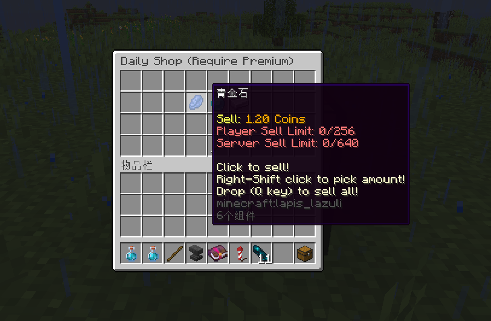

# 📅Example: Daily Shop/Rotating Shop


This example will only work for <mark style="color:red;">**PREMIUM**</mark> version of **UltimateShop**!\
This example is using random placeholder to display different product in one shop, you can also use conditinal placeholder to make different condition display different product, for example of it, please view [here](../placeholders/conditional-placeholder-premium.md#example-conditional-product).


## Create random placeholder

We need to create a random placeholder.&#x20;

Save the random placeholder as `placeholders/random_placeholders/daily.yml`.

The placeholder draws five product IDs from `elements` each day. The menu uses the first three results. Each ID in `elements` must match a key under `items` in the shop file.

Please view [Random Placeholder](../placeholders/random-placeholder-premium.md) page for more info about random placeholder.

```yaml
reset-mode: TIMED
reset-time: '00:00:00'
element-amount: 5
per-player-element: false
element-sort: true
elements:
  - 'redstone'
  - 'iron_ingot'
  - 'gold_ingot'
  - 'copper_ingot'
  - 'diamond'
  - 'lapis_lazuli'
  - 'emerald'
```

## Configure Shop

The various options used in this example are detailed on the [Shops](shops.md) page. If you are unsure of the purpose of each option, please refer to that article.

Add products `A` through `G`; their IDs must match the placeholder elements.

```yaml
settings:
  menu: 'daily-shop-menu' # The menu ID
  buy-more: true
  shop-name: 'Daily Shop (Require Premium)'
  hide-message: false

general-configs:
  price-mode: CLASSIC_ANY
  product-mode: CLASSIC_ANY
  sell-limits:
    global: 640
    default: 18
    vip: 256
  sell-limits-conditions:
    vip:
      1:
        type: permission
        permission: 'group.vip'
  sell-times-reset-mode: 'COOLDOWN_TIMED'
  sell-times-reset-time: '{random_reset}'

items:
  redstone:
    products:
      1:
        material: REDSTONE
        amount: 1
    sell-prices:
      1:
        economy-plugin: Vault
        amount: 1
        placeholder: '&6{amount} Coins'
        start-apply: 0
  iron_ingot:
    products:
      1:
        material: IRON_INGOT
        amount: 1
    sell-prices:
      1:
        economy-plugin: Vault
        amount: 3
        placeholder: '&6{amount} Coins'
        start-apply: 0
  gold_ingot:
    products:
      1:
        material: GOLD_INGOT
        amount: 1
    sell-prices:
      1:
        economy-plugin: Vault
        amount: 1.6
        placeholder: '&6{amount} Coins'
        start-apply: 0
  copper_ingot:
    products:
      1:
        material: COPPER_INGOT
        amount: 1
    sell-prices:
      1:
        economy-plugin: Vault
        amount: 2
        placeholder: '&6{amount} Coins'
        start-apply: 0
  diamond:
    products:
      1:
        material: DIAMOND
        amount: 1
    sell-prices:
      1:
        economy-plugin: Vault
        amount: 0.8
        placeholder: '&6{amount} Coins'
        start-apply: 0
  lapis_lazuli:
    products:
      1:
        material: LAPIS_LAZULI
        amount: 1
      2:
        material: EMERALD
        amount: 1
    sell-prices:
      1:
        economy-plugin: Vault
        amount: 1.2
        placeholder: '&6{amount} Coins'
        start-apply: 0
      2:
        economy-plugin: Vault
        amount: 3.3
        placeholder: '&6{amount} Coins'
        start-apply: 0
  emerald:
    products:
      1:
        material: EMERALD
        amount: 1
    sell-prices:
      1:
        economy-plugin: Vault
        amount: 5
        placeholder: '&6{amount} Coins'
        start-apply: 0
```

## Configure Menu

The various options used in this example are detailed on the [Menus](../menus/general-menus.md) page. If you are unsure of the purpose of each option, please refer to that article.

Each product slot tries the random placeholder first. If that product cannot appear in the slot, `P` shows the product in the corresponding position in the shop file.

```yaml
# PREMIUM version only.

title: '{shop-name}'
size: 36

open-actions:
  1:
    type: sound
    sound: item.book.page_turn

dynamic-layout: true

shop-items: ['P']

layout:
  - '000000000'
  - '000`{random_daily;;1}||P``{random_daily;;2}||P``{random_daily;;3}||P`000'
  - '000000000'
  - 'a0003000b'

buttons:
  3:
    display-item:
      material: ARROW
      name: '&c« Go back'
    actions:
      1:
        type: open_menu
        menu: main
```

## Showcase

<figure><figcaption></figcaption></figure>
