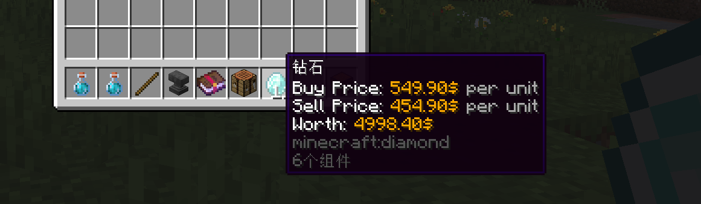

# 💰Product Configuration: Single Entry

This page explains `products`, `buy-prices`, and `sell-prices` based on how the plugin actually processes them.

## What Is a Single Entry?

Each numbered or named entry (`1:`, `2:`, etc.) inside `products`, `buy-prices`, or `sell-prices` is a **single entry**. A product can have as many single entries as you need.

* **`products`**: Optional. What the player receives on buy and must hand over on sell. If omitted, `buy-actions` and `sell-actions` still run, but no items are given or taken (useful for command shops).
* **`buy-prices`**: Optional. What the player pays to buy; without it, the product cannot be bought.
* **`sell-prices`**: Optional. What the player receives on sell; without it, the product cannot be sold.

```yaml
items:
  A:
    products:
      1:
        material: emerald
      2:
        material: diamond
    buy-prices:
      1:
        economy-plugin: Vault
        amount: 100
        placeholder: '{amount}$'
    sell-prices:
      1:
        economy-plugin: Vault
        amount: 20
        placeholder: '{amount}$'
```

Here `products.1`, `products.2`, `buy-prices.1`, and `sell-prices.1` are each a single entry.

## How the Plugin Processes Entries

During a buy or sell, the plugin handles each section in this order:

1. Read all entries under `products`, `buy-prices`, or `sell-prices`.
2. Filter them with each entry's `apply-conditions` (legacy name: `conditions`).
3. Select active entries according to the section mode (`ANY`, `ALL`, `CLASSIC_ANY`, `CLASSIC_ALL`).
4. Calculate each selected entry's `amount`.
5. Check whether the player has enough items or currency.
6. Check each selected entry's `require-conditions`.
7. Give or take the items/currency and run the entry's `give-actions` / `take-actions`.


`apply-conditions` runs **before selection** to decide whether an entry participates; `require-conditions` runs **after selection and amount calculation** to decide whether the trade is allowed to succeed.


## Entry Types

The plugin detects the entry type automatically from the keys you configure.

### Vanilla Item

Uses [ItemFormat™](../../format/itemformat-tm/) for standard Minecraft items. Works in `products`, `buy-prices`, and `sell-prices`.

```yaml
products:
  1:
    material: emerald
  2:
    material: diamond
    amount: 16
```

### Hooked Item

Uses custom items from [compatible plugins](../../info/compatibility.md) via [ItemFormat™](../../format/itemformat-tm/). Works in `products`, `buy-prices`, and `sell-prices`.

```yaml
products:
  1:
    hook-plugin: MMOItems
    hook-item: 'AXE;;MAGIC_AXE'
```

### Match Item

Uses [Custom Item Match Method](../../features/custom-item-match-method.md) to match items by lore, NBT, name, or custom rules when no fixed item ID exists. Works in `buy-prices` and `products`.

```yaml
products:
  1:
    match-item:
      contains-lore:
        - 'Magic Flight Paper'
    amount: 64
```

### Vanilla / Hooked Economy

Operates directly on currency balances using [EconomyFormat™](../../format/economyformat-tm/). Works in `products`, `buy-prices`, and `sell-prices`.

```yaml
buy-prices:
  1:
    economy-plugin: Vault
    amount: 15
    placeholder: '{amount}$'
```

### Custom <mark style="color:red;">- Premium</mark>

Reads a player placeholder via `match-placeholder` to check the current balance, and uses `take-actions` / `give-actions` to modify it—ideal for unsupported currencies or custom stats.

```yaml
buy-prices:
  1:
    match-placeholder: '%player_health%'
    amount: 5
    placeholder: '{amount} Health'
    take-actions:
      1:
        multi-once: true
        type: console_command
        command: 'health take {player} {amount}'
```

### Free / Empty

An entry with no item, economy, `match-item`, or `match-placeholder` is treated as free. Useful for command shops, permission shops, or action-only rewards.

## Entry Options

### `amount`

The base quantity for the entry. Supports fixed numbers, PlaceholderAPI placeholders, [Built-in Placeholders](../../placeholders/built-in-placeholders.md), and [Math Calculate Format](../../format/math-calculate-format.md) formulas.

```yaml
amount: '55 + ({buy-times-server} - {sell-times-server}) * 0.1'
```

### `max-sell-amount`

Optional, placed on an individual `products` or `sell-prices` entry to specify the maximum number of trades **Sell All** can perform for that entry.


With dynamic prices or dynamic amounts, omitting `max-sell-amount` forces the plugin to brute-force trade by trade to find the Sell All cap. Providing a formula lets the plugin compute the cap directly and greatly improves performance. See [Dynamic Price](../../dynamic-prices/dynamic-price.md) for concrete formulas.


**Combining multiple entries:**
* In `ALL` mode, the plugin takes the minimum across all configured formulas.
* In `ANY` mode, limits are summed only when every participating entry defines a formula.

To cap Sell All by remaining Vault income limits, see [Sell Income Limits — How Sell All works out how many times to sell](../../features/sell-income-limits-example.md#how-sell-all-works-out-how-many-times-to-sell).

**Placeholders available in the formula:**

| Placeholder | Where | Meaning |
| --- | --- | --- |
| `{stock}` | `products` only | How many of this item the player currently has (or balance for economy entries) |
| `{sell-unit-income}` | `sell-prices` in `CLASSIC_ANY` / `CLASSIC_ALL` only | Actual payout per trade including sell multiplier; entries sharing the same Shared Price template are summed |
| `{require-conditions.<key>.value}` | `products` and `sell-prices` | The numeric `value` of that `require-conditions` entry |
| `{buy-times-player}`, `{buy-times-server}`, `{buy-times-increment}`, `{sell-times-player}`, `{sell-times-server}`, `{sell-times-increment}` | `products` and `sell-prices` (any mode) | Trade counters before this sale begins, plus the increment per trade |
| `{custom_...}`, `%...%` | All entries | Built-in placeholders and PlaceholderAPI variables; see [Built-in Placeholders](../../placeholders/built-in-placeholders.md) |

**Notes:**

* **Do not use `{amount}` here**—the formula is solving for the trade count, so no count exists yet. Read caps via `{require-conditions.<key>.value}` instead.
* `{buy-times-increment}` and `{sell-times-increment}` reflect the product's increment setting (counts consumed per trade). Use them only when converting remaining counter headroom into trade count, e.g. `max-sell-amount: '({require-conditions.1.value} - {buy-times-server}) / {buy-times-increment}'`.
* `{stock}` is replaced only on `products`; on `sell-prices` it stays literal and the formula is ignored.
* `{sell-unit-income}` exists only on `sell-prices` and is skipped in `ANY` / `ALL` dynamic-price modes (because per-trade payouts vary); use trade counters in those modes as shown in [Dynamic Price](../../dynamic-prices/dynamic-price.md).
* All counters hold their values **before** this sale begins (so a first-time seller has `{sell-times-player} = 0`).
* Results are floored to an integer, clamped at `0`, and never exceed stock, `sell-limits`, or `sell.max-amount`.
* Invalid formulas (typo, divide-by-zero, `math.enabled` off) are silently ignored without failing the sale; functions like `min()`, `max()`, and `ceil()` require `math.enable-function`.
* When `price-modifier: true` is enabled on a product, `sell-prices` formulas are ignored.

**Example (stock limit on `products`, daily income cap on `sell-prices`):**

```yaml
products:
  1:
    material: EMERALD
    amount: 4
    max-sell-amount: '{stock} / 4'

sell-prices:
  1:
    economy-plugin: Vault
    amount: 20
    placeholder: '{amount}$'
    max-sell-amount: '({require-conditions.1.value} - {custom_sell_daily}) / {sell-unit-income}'
    require-conditions:
      1:
        type: placeholder
        placeholder: '{custom_sell_daily} + {amount}'
        rule: '<='
        value: '10000'
```

### `apply-conditions` and `require-conditions`

* **`apply-conditions`**: Decides whether the entry enters the candidate pool. If it fails, the entry is ignored (great for VIP pricing tiers or conditional rewards).
* **`require-conditions`**: Checked after the entry is selected and its amount is calculated. If it fails, the trade is blocked (great for permission checks or income limits).

```yaml
products:
  1:
    material: PAPER
    amount: 1
  2:
    material: PAPER
    amount: 2
    apply-conditions:
      1:
        type: permission
        permission: group.vip

buy-prices:
  1:
    economy-plugin: Vault
    amount: 50
    placeholder: '{amount}$'
    require-conditions:
      1:
        type: permission
        permission: shop.buy.special
```

Regular players receive `products.1`, while VIPs also receive `products.2`. Meanwhile `buy-prices.1` is always selected, but players without `shop.buy.special` are blocked at checkout.

### `give-actions` and `take-actions`

* **`give-actions`**: Executed when this entry is given to the player (command rewards, permissions, custom currency payouts).
* **`take-actions`**: Executed when this entry is taken from the player (custom currency deductions, cost commands).

### `give-item` and `take`

* **`give-item`**: For item-like entries. Set to `false` to skip giving the physical item while still running `give-actions` (standard for command shops).
* **`take`**: Set to `false` to require the player to hold the item without consuming it.

## Entry Actions vs. Item Actions

* **Entry actions (`give-actions` / `take-actions`)**: Run only when **that specific entry** is selected and given/taken. Here `{amount}` is **that entry's final amount**.
* **Item actions (`buy-actions` / `sell-actions`)**: Run whenever the **whole buy or sell trade succeeds**, regardless of which branch was chosen. Here `{amount}` is the **product-level trade amount** (typically the GUI quantity; or the trade count if `display-item.calculate-amount` is off).

```yaml
products:
  1:
    material: PAPER
    amount: 4
    give-actions:
      1:
        type: message
        message: 'Single thing amount = {amount}'

buy-actions:
  1:
    type: message
    message: 'Item action amount = {amount}'
```

Rule of thumb: branch-specific logic belongs in entry actions; trade-wide notifications, sounds, or logs belong in item actions.

## Price-Only Options

* **`placeholder`**: Display text for `{buy-price}` / `{sell-price}` placeholders (e.g. `placeholder: '{amount}$'`). Supports `{amount}`, `{status}` (dynamic price status), `{display}` (item name; adds performance cost), and PlaceholderAPI.
* **`start-apply` / `end-apply` / `apply`**: Controls the trade-count window in which the price applies (effective in `ANY` / `ALL` modes).
* **`min-amount` and `max-amount`**: Clamps dynamic formula results.

```yaml
buy-prices:
  1:
    economy-plugin: Vault
    amount: '55 + {buy-times-player} * 0.5'
    min-amount: 55
    max-amount: 500
    placeholder: '{amount}$'
```

## Modes: `ANY`, `ALL`, `CLASSIC_ANY`, `CLASSIC_ALL`

* **`CLASSIC_ALL`**: Uses all applicable entries as a fixed bundle (recommended default for standard shops).
* **`CLASSIC_ANY`**: Picks one applicable entry as a fixed choice.
* **`ALL`**: Uses all applicable entries and recalculates dynamic formulas / `start-apply` windows per trade in a batch.
* **`ANY`**: Picks one applicable entry with dynamic windows that shift as counts change.

Start with `CLASSIC_ALL`, use `CLASSIC_ANY` for "pick one of several", and switch to `ALL` / `ANY` only when using dynamic formulas or apply windows.

## Shared Condition Keys

You can define shared `apply-conditions` section keys in `config.yml` (`require-conditions` still stays inside each entry):

```yaml
conditions:
  products-key: 'products-conditions'
  buy-prices-key: 'buy-prices-conditions'
  sell-prices-key: 'sell-prices-conditions'
  display-item-key: 'display-item-conditions'
```

```yaml
products:
  one:
    material: REDSTONE
  two:
    material: IRON_INGOT

products-conditions:
  one:
    1:
      type: placeholder
      placeholder: '{random_daily}'
      rule: '=='
      value: 'A'
  two:
    1:
      type: placeholder
      placeholder: '{random_daily}'
      rule: '=='
      value: 'B'
```

## Common Patterns

### Pattern A: Normal Item Shop

```yaml
A:
  price-mode: CLASSIC_ALL
  product-mode: CLASSIC_ALL
  products:
    1:
      material: APPLE
      amount: 64
  buy-prices:
    1:
      economy-plugin: Vault
      amount: 150
      placeholder: '{amount}$'
  sell-prices:
    1:
      economy-plugin: Vault
      amount: 30
      placeholder: '{amount}$'
```

### Pattern B: Command Shop

You can omit `products` and use `buy-actions` (with a manual `display-item`), or define a dummy product with `give-item: false` and `give-actions`. The second approach lets you attach `apply-conditions` for per-group rewards:

```yaml
  A:
    price-mode: CLASSIC_ALL
    product-mode: CLASSIC_ALL
    display-item:
      name: 'Magic Crate Key'
      material: PAPER
      custom-model-data: 500
      amount: 1
    buy-prices:
      1:
        economy-plugin: Vault
        amount: 150
        placeholder: '{amount}⛂'
    buy-actions:
      1:
        type: console_command
        command: "crate give {player} magic"
      2:
        # Add multi-once: true when using {amount} in a command for bulk purchases
        multi-once: true
        type: console_command
        command: "crate give {player} magic {amount}"

  B:
    price-mode: CLASSIC_ALL
    product-mode: CLASSIC_ALL
    products:
      1:
        name: 'Magic Crate Key'
        material: PAPER
        custom-model-data: 500
        amount: 1
        give-item: false
        give-actions:
          1:
            multi-once: true
            type: console_command
            command: "crate give {player} magic {amount}"
      2:
        name: 'Magic Crate Key (VIP bonus)'
        material: PAPER
        custom-model-data: 500
        amount: 1
        give-item: false
        give-actions:
          1:
            multi-once: true
            type: console_command
            command: "crate give {player} magic {amount}"
        apply-conditions:
          1:
            type: permission
            permission: group.vip
    buy-prices:
      1:
        economy-plugin: Vault
        amount: 150
        placeholder: '{amount}⛂'
```

## Auto Display Price in Item Lore

To show shop buy/sell prices directly on items in players' inventories using **MythicChanger** (requires `packetevents`):

1. Install [MythicChanger](https://www.spigotmc.org/resources/mythicchanger-auto-match-change-drag-change-gui-change-in-1-plugin-1-14-1-21-8.98523/).
2. Create `plugins/MythicChanger/rules/shop-display.yml`.
3. Paste the config below and restart the server:

```yaml
weight: 15

only-in-player-inventory: true

fake-changes:
  add-price-lore:
    - '&fBuy Price: &6{buy-price} &7per unit'
    - '&fSell Price: &6{sell-price} &7per unit'
    - '&fWorth: &6{total-price}'
```

<figure><figcaption></figcaption></figure>
